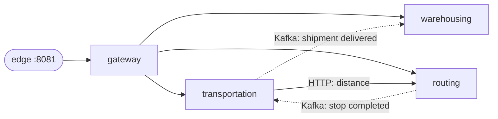
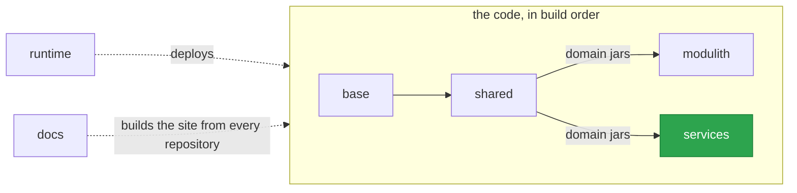

# FF Logistic: services

**FF Logistic as three Spring Boot services behind a gateway: the same business areas, wired over the network.**

Part of **[FF Logistic](https://github.com/ffetih/ff-logistic-docs)**: one logistics product built twice, as a modular monolith and as microservices, on the same Kubernetes platform, behind one switch. The business rules are written once; only the wiring differs. Start at the hub for the whole picture.

## What's here

| Path | Port | What |
| :--- | :--- | :--- |
| `contexts/warehousing` | 8082 | The warehousing core with the chassis |
| `contexts/transportation` | 8083 | The transportation core with the chassis |
| `contexts/routing` | 8084 | The routing core with the chassis |
| `gateway` | 8081 | nginx: `/api/v1/wms`, `/tms`, `/geo` to their service |
| `deploy/apps/*` | | Their values for the runtime's chart; the switch deploys them when `active: services` |

The same three flows as the modulith, over the network:

| Flow | Here |
| :--- | :--- |
| A road leg's distance (transportation asks routing) | HTTP with the caller's token, 1 s connect and 2 s read timeouts; no answer, and the core falls back to a straight-line estimate |
| A delivery opens an arrival at the warehouse | Transportation's outbox, Kafka (`ff.logistics.tms.shipment-delivered`), warehousing's consumer, a dead-letter topic |
| A completed route stop delivers its shipment | Routing's outbox, Kafka (`ff.logistics.geo.route-stop-completed`), transportation's consumer |



Each service keeps its own outbox schema and applies only its own area's migrations; the tests run a real Kafka broker in the test JVM.

## Build

```bash
./build.sh    # after base and shared are installed
```

CI builds an image only for a service whose folder changed; "Run workflow" rebuilds all of them, for a change in base or shared.

## Where it fits

Six repositories: base, then shared, then modulith and services are built in that order; runtime deploys them; docs builds the documentation site from all six. This one is green.



## Read more

- This repository's page on the documentation site: [Services](https://ffetih.github.io/ff-logistic-docs/services/index.html)
- The hub, with the architecture, the decisions and the plan: [ff-logistic-docs](https://github.com/ffetih/ff-logistic-docs)
- Every page, in one site: [ffetih.github.io/ff-logistic-docs](https://ffetih.github.io/ff-logistic-docs/)
